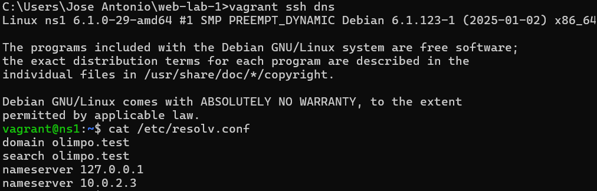
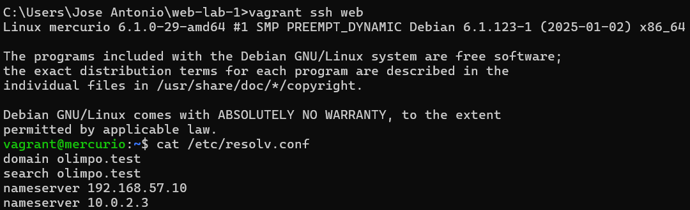

# Initial Deployment

Command:

```bash
vagrant up
```

Output:

```
Bringing machine 'dns' up with 'virtualbox' provider...
Bringing machine 'web' up with 'virtualbox' provider...
==> dns: Cloning VM...
==> dns: Matching MAC address for NAT networking...
==> dns: Checking if box 'debian/bookworm64' version '12.20250126.1' is up to date...
==> dns: Setting the name of the VM: web-lab-1_dns_1794598582222_76576
==> dns: Clearing any previously set network interfaces...
==> dns: Preparing network interfaces based on configuration...
    dns: Adapter 1: nat
    dns: Adapter 2: hostonly
==> dns: Forwarding ports...
    dns: 22 (guest) => 2222 (host) (adapter 1)
==> dns: Running 'pre-boot' VM customizations...
==> dns: Booting VM...
==> dns: Waiting for machine to boot. This may take a few minutes...
    dns: SSH address: 127.0.0.1:2222
    dns: SSH username: vagrant
    dns: SSH auth method: private key
    dns: Warning: Connection reset. Retrying...
    dns: Warning: Remote connection disconnect. Retrying...
==> dns: Machine booted and ready!
==> dns: Checking for guest additions in VM...
    dns: The guest additions on this VM do not match the installed version of
    dns: VirtualBox! In most cases this is fine, but in rare cases it can
    dns: prevent things such as shared folders from working properly. If you see
    dns: shared folder errors, please make sure the guest additions within the
    dns: virtual machine match the version of VirtualBox you have installed on
    dns: your host and reload your VM.
    dns:
    dns: Guest Additions Version: 6.0.0 r127566
    dns: VirtualBox Version: 7.2
==> dns: Setting hostname...
==> dns: Configuring and enabling network interfaces...
==> dns: Mounting shared folders...
    dns: C:/Users/Jose Antonio/web-lab-1 => /vagrant
==> dns: Running provisioner: shell...
    dns: Running: inline script
    dns: Get:1 https://deb.debian.org/debian bookworm InRelease [151 kB]
    dns: Get:2 https://security.debian.org/debian-security bookworm-security InRelease [34.8 kB]
    dns: Get:3 https://deb.debian.org/debian bookworm-updates InRelease [55.4 kB]
    dns: Get:4 https://deb.debian.org/debian bookworm-backports InRelease [59.4 kB]
    dns: Get:5 https://deb.debian.org/debian bookworm/main Sources [9492 kB]
    dns: Get:6 https://deb.debian.org/debian bookworm/main amd64 Packages [8790 kB]
    dns: Get:7 https://deb.debian.org/debian bookworm/main Translation-en [6107 kB]
    dns: Get:8 https://security.debian.org/debian-security bookworm-security/main Sources [289 kB]
    dns: Get:9 https://deb.debian.org/debian bookworm-updates/main Sources [3288 B]
    dns: Get:10 https://deb.debian.org/debian bookworm-updates/main amd64 Packages [6924 B]
    dns: Get:11 https://deb.debian.org/debian bookworm-updates/main Translation-en [5448 B]
    dns: Get:12 https://security.debian.org/debian-security bookworm-security/main amd64 Packages [370 kB]
    dns: Get:13 https://security.debian.org/debian-security bookworm-security/main Translation-en [232 kB]
    dns: Get:14 https://deb.debian.org/debian bookworm-backports/main Sources [320 kB]
    dns: Get:15 https://deb.debian.org/debian bookworm-backports/main amd64 Packages [300 kB]
    dns: Get:16 https://deb.debian.org/debian bookworm-backports/main Translation-en [252 kB]
    dns: Fetched 26.5 MB in 6s (4528 kB/s)
    dns: Reading package lists...
==> dns: Running provisioner: bind9 (shell)...
    dns: Running: inline script
    dns: Reading package lists...
    dns: Building dependency tree...
    dns: Reading state information...
    dns: The following additional packages will be installed:
    dns:   bind9-host bind9-libs bind9-utils dns-root-data
    dns: Suggested packages:
    dns:   bind-doc resolvconf ufw
    dns: The following NEW packages will be installed:
    dns:   bind9 bind9-utils dns-root-data
    dns: The following packages will be upgraded:
    dns:   bind9-dnsutils bind9-host bind9-libs
    dns: 3 upgraded, 3 newly installed, 0 to remove and 99 not upgraded.
    dns: Need to get 1824 kB of archives.
    dns: After this operation, 880 kB of additional disk space will be used.
    dns: Get:1 https://security.debian.org/debian-security bookworm-security/main amd64 bind9-host amd64 1:9.18.49-1~deb12u3 [57.6 kB]
    dns: Get:2 https://deb.debian.org/debian bookworm/main amd64 dns-root-data all 2024071801~deb12u1 [5752 B]
    dns: Get:3 https://security.debian.org/debian-security bookworm-security/main amd64 bind9-dnsutils amd64 1:9.18.49-1~deb12u3 [158 kB]
    dns: Get:4 https://security.debian.org/debian-security bookworm-security/main amd64 bind9-libs amd64 1:9.18.49-1~deb12u3 [1186 kB]
    dns: Get:5 https://security.debian.org/debian-security bookworm-security/main amd64 bind9-utils amd64 1:9.18.49-1~deb12u3 [163 kB]
    dns: Get:6 https://security.debian.org/debian-security bookworm-security/main amd64 bind9 amd64 1:9.18.49-1~deb12u3 [253 kB]
    dns: apt-listchanges: Reading changelogs...
    dns: dpkg-preconfigure: unable to re-open stdin: No such file or directory
    dns: Fetched 1824 kB in 1s (3593 kB/s)
(Reading database ... 25481 files and directories currently installed.)
    dns: Preparing to unpack .../0-bind9-host_1%3a9.18.49-1~deb12u3_amd64.deb ...
    dns: Unpacking bind9-host (1:9.18.49-1~deb12u3) over (1:9.18.28-1~deb12u2) ...
    dns: Preparing to unpack .../1-bind9-dnsutils_1%3a9.18.49-1~deb12u3_amd64.deb ...
    dns: Unpacking bind9-dnsutils (1:9.18.49-1~deb12u3) over (1:9.18.28-1~deb12u2) ...
    dns: Preparing to unpack .../2-bind9-libs_1%3a9.18.49-1~deb12u3_amd64.deb ...
    dns: Unpacking bind9-libs:amd64 (1:9.18.49-1~deb12u3) over (1:9.18.28-1~deb12u2) ...
    dns: Selecting previously unselected package bind9-utils.
    dns: Preparing to unpack .../3-bind9-utils_1%3a9.18.49-1~deb12u3_amd64.deb ...
    dns: Unpacking bind9-utils (1:9.18.49-1~deb12u3) ...
    dns: Selecting previously unselected package dns-root-data.
    dns: Preparing to unpack .../4-dns-root-data_2024071801~deb12u1_all.deb ...
    dns: Unpacking dns-root-data (2024071801~deb12u1) ...
    dns: Selecting previously unselected package bind9.
    dns: Preparing to unpack .../5-bind9_1%3a9.18.49-1~deb12u3_amd64.deb ...
    dns: Unpacking bind9 (1:9.18.49-1~deb12u3) ...
    dns: Setting up bind9-libs:amd64 (1:9.18.49-1~deb12u3) ...
    dns: Setting up dns-root-data (2024071801~deb12u1) ...
    dns: Setting up bind9-utils (1:9.18.49-1~deb12u3) ...
    dns: Setting up bind9 (1:9.18.49-1~deb12u3) ...
    dns: Adding group `bind' (GID 110) ...
    dns: Done.
    dns: Adding system user `bind' (UID 103) ...
    dns: Adding new user `bind' (UID 103) with group `bind' ...
    dns: Not creating home directory `/var/cache/bind'.
    dns: wrote key file "/etc/bind/rndc.key"
    dns: named-resolvconf.service is a disabled or a static unit, not starting it.
    dns: Created symlink /etc/systemd/system/bind9.service → /lib/systemd/system/named.service.
    dns: Created symlink /etc/systemd/system/multi-user.target.wants/named.service → /lib/systemd/system/named.service.
    dns: Setting up bind9-host (1:9.18.49-1~deb12u3) ...
    dns: Setting up bind9-dnsutils (1:9.18.49-1~deb12u3) ...
    dns: Processing triggers for man-db (2.11.2-2) ...
    dns: Processing triggers for libc-bin (2.36-9+deb12u9) ...
==> dns: Running provisioner: dns-resolv (shell)...
    dns: Running: inline script
    dns: '/vagrant/files/ns1.olimpo.test/resolv.conf' -> '/etc/resolv.conf'
==> dns: Running provisioner: dns-provision (shell)...
    dns: Running: script: dns-provision
    dns: '/vagrant/files/ns1.olimpo.test/named' -> '/etc/default/named'
    dns: '/vagrant/files/ns1.olimpo.test/named.conf.options' -> '/etc/bind/named.conf.options'
    dns: '/vagrant/files/ns1.olimpo.test/named.conf.local' -> '/etc/bind/named.conf.local'
    dns: '/vagrant/files/ns1.olimpo.test/olimpo.test.dns' -> '/var/lib/bind/olimpo.test.dns'
    dns: '/vagrant/files/ns1.olimpo.test/192.168.57.dns' -> '/var/lib/bind/192.168.57.dns'
    dns: ● named.service - BIND Domain Name Server
    dns:      Loaded: loaded (/lib/systemd/system/named.service; enabled; preset: enabled)
    dns:      Active: active (running) since Fri 2026-11-13 19:37:47 UTC; 26ms ago
    dns:        Docs: man:named(8)
    dns:    Main PID: 2054 (named)
    dns:      Status: "running"
    dns:       Tasks: 6 (limit: 194)
    dns:      Memory: 23.6M
    dns:         CPU: 109ms
    dns:      CGroup: /system.slice/named.service
    dns:              └─2054 /usr/sbin/named -f -u bind -4
    dns:
    dns: Nov 13 19:37:47 ns1 named[2054]: managed-keys-zone: loaded serial 1
    dns: Nov 13 19:37:47 ns1 named[2054]: zone 0.in-addr.arpa/IN: loaded serial 1
    dns: Nov 13 19:37:47 ns1 named[2054]: zone 255.in-addr.arpa/IN: loaded serial 1
    dns: Nov 13 19:37:47 ns1 named[2054]: zone 127.in-addr.arpa/IN: loaded serial 1
    dns: Nov 13 19:37:47 ns1 named[2054]: zone localhost/IN: loaded serial 2
    dns: Nov 13 19:37:47 ns1 named[2054]: zone 57.168.192.in-addr.arpa/IN: loaded serial 1
    dns: Nov 13 19:37:47 ns1 named[2054]: zone olimpo.test/IN: loaded serial 1
    dns: Nov 13 19:37:47 ns1 named[2054]: all zones loaded
    dns: Nov 13 19:37:47 ns1 systemd[1]: Started named.service - BIND Domain Name Server.
    dns: Nov 13 19:37:47 ns1 named[2054]: running
==> web: Cloning VM...
==> web: Matching MAC address for NAT networking...
==> web: Checking if box 'debian/bookworm64' version '12.20250126.1' is up to date...
==> web: Setting the name of the VM: web-lab-1_web_1794598673006_99990
==> web: Fixed port collision for 22 => 2222. Now on port 2200.
==> web: Clearing any previously set network interfaces...
==> web: Preparing network interfaces based on configuration...
    web: Adapter 1: nat
    web: Adapter 2: hostonly
==> web: Forwarding ports...
    web: 22 (guest) => 2200 (host) (adapter 1)
==> web: Running 'pre-boot' VM customizations...
==> web: Booting VM...
==> web: Waiting for machine to boot. This may take a few minutes...
    web: SSH address: 127.0.0.1:2200
    web: SSH username: vagrant
    web: SSH auth method: private key
    web: Warning: Connection reset. Retrying...
    web: Warning: Connection aborted. Retrying...
==> web: Machine booted and ready!
==> web: Checking for guest additions in VM...
    web: The guest additions on this VM do not match the installed version of
    web: VirtualBox! In most cases this is fine, but in rare cases it can
    web: prevent things such as shared folders from working properly. If you see
    web: shared folder errors, please make sure the guest additions within the
    web: virtual machine match the version of VirtualBox you have installed on
    web: your host and reload your VM.
    web:
    web: Guest Additions Version: 6.0.0 r127566
    web: VirtualBox Version: 7.2
==> web: Setting hostname...
==> web: Configuring and enabling network interfaces...
==> web: Mounting shared folders...
    web: C:/Users/Jose Antonio/web-lab-1 => /vagrant
    web: C:/Users/Jose Antonio/web-lab-1/files/apolo.olimpo.test => /var/www/apolo.olimpo.test
    web: C:/Users/Jose Antonio/web-lab-1/files/atenea.olimpo.test => /var/www/atenea.olimpo.test
==> web: Running provisioner: shell...
    web: Running: inline script
    web: Get:1 https://security.debian.org/debian-security bookworm-security InRelease [34.8 kB]
    web: Get:2 https://deb.debian.org/debian bookworm InRelease [151 kB]
    web: Get:3 https://deb.debian.org/debian bookworm-updates InRelease [55.4 kB]
    web: Get:4 https://deb.debian.org/debian bookworm-backports InRelease [59.4 kB]
    web: Get:5 https://security.debian.org/debian-security bookworm-security/main Sources [289 kB]
    web: Get:6 https://security.debian.org/debian-security bookworm-security/main amd64 Packages [370 kB]
    web: Get:7 https://security.debian.org/debian-security bookworm-security/main Translation-en [232 kB]
    web: Get:8 https://deb.debian.org/debian bookworm/main Sources [9492 kB]
    web: Get:9 https://deb.debian.org/debian bookworm/main amd64 Packages [8790 kB]
    web: Get:10 https://deb.debian.org/debian bookworm/main Translation-en [6107 kB]
    web: Get:11 https://deb.debian.org/debian bookworm-updates/main Sources [3288 B]
    web: Get:12 https://deb.debian.org/debian bookworm-updates/main amd64 Packages [6924 B]
    web: Get:13 https://deb.debian.org/debian bookworm-updates/main Translation-en [5448 B]
    web: Get:14 https://deb.debian.org/debian bookworm-backports/main Sources [320 kB]
    web: Get:15 https://deb.debian.org/debian bookworm-backports/main amd64 Packages [300 kB]
    web: Get:16 https://deb.debian.org/debian bookworm-backports/main Translation-en [252 kB]
    web: Fetched 26.5 MB in 6s (4554 kB/s)
    web: Reading package lists...
==> web: Running provisioner: mercurio-resolv (shell)...
    web: Running: script: mercurio-resolv
    web: '/vagrant/files/mercurio.olimpo.test/resolv.conf' -> '/etc/resolv.conf'
==> web: Running provisioner: apache2 (shell)...
    web: Running: script: apache2
    web: Reading package lists...
    web: Building dependency tree...
    web: Reading state information...
    web: The following additional packages will be installed:
    web:   apache2-bin apache2-data apache2-utils libapr1 libaprutil1
    web:   libaprutil1-dbd-sqlite3 libaprutil1-ldap libcurl3-gnutls libcurl4
    web:   liblua5.3-0 ssl-cert
    web: Suggested packages:
    web:   apache2-doc apache2-suexec-pristine | apache2-suexec-custom www-browser
    web: The following NEW packages will be installed:
    web:   apache2 apache2-bin apache2-data apache2-utils libapr1 libaprutil1
    web:   libaprutil1-dbd-sqlite3 libaprutil1-ldap libcurl4 liblua5.3-0 ssl-cert
    web: The following packages will be upgraded:
    web:   libcurl3-gnutls
    web: 1 upgraded, 11 newly installed, 0 to remove and 101 not upgraded.
    web: Need to get 3171 kB of archives.
    web: After this operation, 9313 kB of additional disk space will be used.
    web: Get:1 https://deb.debian.org/debian bookworm/main amd64 libapr1 amd64 1.7.2-3+deb12u1 [102 kB]
    web: Get:2 https://security.debian.org/debian-security bookworm-security/main amd64 libaprutil1 amd64 1.6.3-1+deb12u1 [89.0 kB]
    web: Get:3 https://deb.debian.org/debian bookworm/main amd64 libcurl4 amd64 7.88.1-10+deb12u15 [392 kB]
    web: Get:4 https://security.debian.org/debian-security bookworm-security/main amd64 libaprutil1-dbd-sqlite3 amd64 1.6.3-1+deb12u1 [14.0 kB]
    web: Get:5 https://security.debian.org/debian-security bookworm-security/main amd64 libaprutil1-ldap amd64 1.6.3-1+deb12u1 [12.3 kB]
    web: Get:6 https://security.debian.org/debian-security bookworm-security/main amd64 apache2-bin amd64 2.4.71-1~deb12u1 [1410 kB]
    web: Get:7 https://deb.debian.org/debian bookworm/main amd64 liblua5.3-0 amd64 5.3.6-2 [123 kB]
    web: Get:8 https://deb.debian.org/debian bookworm/main amd64 libcurl3-gnutls amd64 7.88.1-10+deb12u15 [386 kB]
    web: Get:9 https://deb.debian.org/debian bookworm/main amd64 ssl-cert all 1.1.2 [21.1 kB]
    web: Get:10 https://security.debian.org/debian-security bookworm-security/main amd64 apache2-data all 2.4.71-1~deb12u1 [160 kB]
    web: Get:11 https://security.debian.org/debian-security bookworm-security/main amd64 apache2-utils amd64 2.4.71-1~deb12u1 [224 kB]
    web: Get:12 https://security.debian.org/debian-security bookworm-security/main amd64 apache2 amd64 2.4.71-1~deb12u1 [238 kB]
    web: apt-listchanges: Reading changelogs...
    web: dpkg-preconfigure: unable to re-open stdin: No such file or directory
    web: Fetched 3171 kB in 1s (4393 kB/s)
    web: Selecting previously unselected package libapr1:amd64.
(Reading database ... 25481 files and directories currently installed.)
    web: Preparing to unpack .../00-libapr1_1.7.2-3+deb12u1_amd64.deb ...
    web: Unpacking libapr1:amd64 (1.7.2-3+deb12u1) ...
    web: Selecting previously unselected package libaprutil1:amd64.
    web: Preparing to unpack .../01-libaprutil1_1.6.3-1+deb12u1_amd64.deb ...
    web: Unpacking libaprutil1:amd64 (1.6.3-1+deb12u1) ...
    web: Selecting previously unselected package libaprutil1-dbd-sqlite3:amd64.
    web: Preparing to unpack .../02-libaprutil1-dbd-sqlite3_1.6.3-1+deb12u1_amd64.deb ...
    web: Unpacking libaprutil1-dbd-sqlite3:amd64 (1.6.3-1+deb12u1) ...
    web: Selecting previously unselected package libaprutil1-ldap:amd64.
    web: Preparing to unpack .../03-libaprutil1-ldap_1.6.3-1+deb12u1_amd64.deb ...
    web: Unpacking libaprutil1-ldap:amd64 (1.6.3-1+deb12u1) ...
    web: Selecting previously unselected package libcurl4:amd64.
    web: Preparing to unpack .../04-libcurl4_7.88.1-10+deb12u15_amd64.deb ...
    web: Unpacking libcurl4:amd64 (7.88.1-10+deb12u15) ...
    web: Selecting previously unselected package liblua5.3-0:amd64.
    web: Preparing to unpack .../05-liblua5.3-0_5.3.6-2_amd64.deb ...
    web: Unpacking liblua5.3-0:amd64 (5.3.6-2) ...
    web: Selecting previously unselected package apache2-bin.
    web: Preparing to unpack .../06-apache2-bin_2.4.71-1~deb12u1_amd64.deb ...
    web: Unpacking apache2-bin (2.4.71-1~deb12u1) ...
    web: Selecting previously unselected package apache2-data.
    web: Preparing to unpack .../07-apache2-data_2.4.71-1~deb12u1_all.deb ...
    web: Unpacking apache2-data (2.4.71-1~deb12u1) ...
    web: Selecting previously unselected package apache2-utils.
    web: Preparing to unpack .../08-apache2-utils_2.4.71-1~deb12u1_amd64.deb ...
    web: Unpacking apache2-utils (2.4.71-1~deb12u1) ...
    web: Selecting previously unselected package apache2.
    web: Preparing to unpack .../09-apache2_2.4.71-1~deb12u1_amd64.deb ...
    web: Unpacking apache2 (2.4.71-1~deb12u1) ...
    web: Preparing to unpack .../10-libcurl3-gnutls_7.88.1-10+deb12u15_amd64.deb ...
    web: Unpacking libcurl3-gnutls:amd64 (7.88.1-10+deb12u15) over (7.88.1-10+deb12u8) ...
    web: Selecting previously unselected package ssl-cert.
    web: Preparing to unpack .../11-ssl-cert_1.1.2_all.deb ...
    web: Unpacking ssl-cert (1.1.2) ...
    web: Setting up libapr1:amd64 (1.7.2-3+deb12u1) ...
    web: Setting up libcurl3-gnutls:amd64 (7.88.1-10+deb12u15) ...
    web: Setting up ssl-cert (1.1.2) ...
    web: Setting up liblua5.3-0:amd64 (5.3.6-2) ...
    web: Setting up libcurl4:amd64 (7.88.1-10+deb12u15) ...
    web: Setting up apache2-data (2.4.71-1~deb12u1) ...
    web: Setting up libaprutil1:amd64 (1.6.3-1+deb12u1) ...
    web: Setting up libaprutil1-ldap:amd64 (1.6.3-1+deb12u1) ...
    web: Setting up libaprutil1-dbd-sqlite3:amd64 (1.6.3-1+deb12u1) ...
    web: Setting up apache2-utils (2.4.71-1~deb12u1) ...
    web: Setting up apache2-bin (2.4.71-1~deb12u1) ...
    web: Setting up apache2 (2.4.71-1~deb12u1) ...
    web: Enabling module mpm_event.
    web: Enabling module authz_core.
    web: Enabling module authz_host.
    web: Enabling module authn_core.
    web: Enabling module auth_basic.
    web: Enabling module access_compat.
    web: Enabling module authn_file.
    web: Enabling module authz_user.
    web: Enabling module alias.
    web: Enabling module dir.
    web: Enabling module autoindex.
    web: Enabling module env.
    web: Enabling module mime.
    web: Enabling module negotiation.
    web: Enabling module setenvif.
    web: Enabling module filter.
    web: Enabling module deflate.
    web: Enabling module status.
    web: Enabling module reqtimeout.
    web: Enabling conf charset.
    web: Enabling conf localized-error-pages.
    web: Enabling conf other-vhosts-access-log.
    web: Enabling conf security.
    web: Enabling conf serve-cgi-bin.
    web: Enabling site 000-default.
    web: Created symlink /etc/systemd/system/multi-user.target.wants/apache2.service → /lib/systemd/system/apache2.service.
    web: Created symlink /etc/systemd/system/multi-user.target.wants/apache-htcacheclean.service → /lib/systemd/system/apache-htcacheclean.service.
    web: Processing triggers for man-db (2.11.2-2) ...
    web: Processing triggers for libc-bin (2.36-9+deb12u9) ...
==> web: Running provisioner: apache2-provision (shell)...
    web: Running: script: apache2-provision

==> dns: Machine 'dns' has a post `vagrant up` message. This is a message
==> dns: from the creator of the Vagrantfile, and not from Vagrant itself:
==> dns:
==> dns: Vanilla Debian box. See https://app.vagrantup.com/debian for help and bug reports

==> web: Machine 'web' has a post `vagrant up` message. This is a message
==> web: from the creator of the Vagrantfile, and not from Vagrant itself:
==> web:
==> web: Vanilla Debian box. See https://app.vagrantup.com/debian for help and bug reports

```

Now you'll have two machines: dns and web. inside both machines ("vagrant ssh dns" and "vagrant ssh web")

Command:

```bash
cat /etc/resolv.conf
```

Output:



