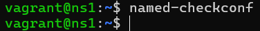
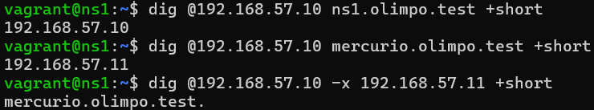
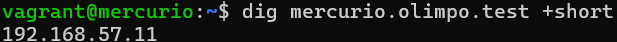

# DNS server configuration checks

Inside the dns machine.

Command:

```bash
cat /etc/bind/named.conf.options
```

Output:

```
# named.conf.options
#
# Fernando Raya <fraya@ieszaidinvergeles.org>

acl trusted {
    127.0.0.0/8;
    192.168.57.0/24;
};

options {
        directory "/var/cache/bind";

        allow-recursion {
          trusted;
        };

        forwarders {
              1.1.1.1;
        };

        dnssec-validation yes;

        listen-on-v6 { any; };
};
```

dnssec-validation is enabled and the forwarder 1.1.1.1 is configured.

Command:

```bash
cat /etc/bind/named.conf.local
```

Output:

```
# named.conf.local
#
# Fernando Raya <fraya@ieszaidinvergeles.org>

zone "olimpo.test" {
     type master;
     file "/var/lib/bind/olimpo.test.dns";
};

zone "57.168.192.in-addr.arpa" {
     type master;
     file "/var/lib/bind/192.168.57.dns";
};
```

Command:

```bash
named-checkconf
```

Output:



The command "named-checkconf" has no output. This indicates that the syntax of the BIND9 configuration files is correct.

```bash
dig @192.168.57.10 ns1.olimpo.test +short
dig @192.168.57.10 mercurio.olimpo.test +short
dig @192.168.57.10 -x 192.168.57.11 +short

```

Output:



Command:

```bash
nslookup mercurio.olimpo.test 192.168.57.10
```

Output:

```
Server:         192.168.57.10
Address:        192.168.57.10#53

Name:   mercurio.olimpo.test
Address: 192.168.57.11


```

Command:

```bash
nslookup mercurio
```

Output:

```
Server:         127.0.0.1
Address:        127.0.0.1#53

Name:   mercurio.olimpo.test
Address: 192.168.57.11


```

Command:

```bash
dig @192.168.57.10 www.google.es
```

Output:

```

; <<>> DiG 9.18.49-1~deb12u3-Debian <<>> @192.168.57.10 www.google.es
; (1 server found)
;; global options: +cmd
;; Got answer:
;; ->>HEADER<<- opcode: QUERY, status: NOERROR, id: 64565
;; flags: qr rd ra; QUERY: 1, ANSWER: 1, AUTHORITY: 0, ADDITIONAL: 1

;; OPT PSEUDOSECTION:
; EDNS: version: 0, flags:; udp: 1232
; COOKIE: 0227d2ffb7c62b52010000006af769058dca96b4a047f483 (good)
;; QUESTION SECTION:
;www.google.es.                 IN      A

;; ANSWER SECTION:
www.google.es.          300     IN      A       142.251.208.131

;; Query time: 23 msec
;; SERVER: 192.168.57.10#53(192.168.57.10) (UDP)
;; WHEN: Fri Nov 13 19:46:14 UTC 2026
;; MSG SIZE  rcvd: 86

```

# DNS checks from mercurio

Inside the web machine.

Command:

```bash
dig mercurio.olimpo.test +short
```

Output:



Command:

```bash
nslookup ns1.olimpo.test
```

Output:

```
Server:         192.168.57.10
Address:        192.168.57.10#53

Name:   ns1.olimpo.test
Address: 192.168.57.10

```